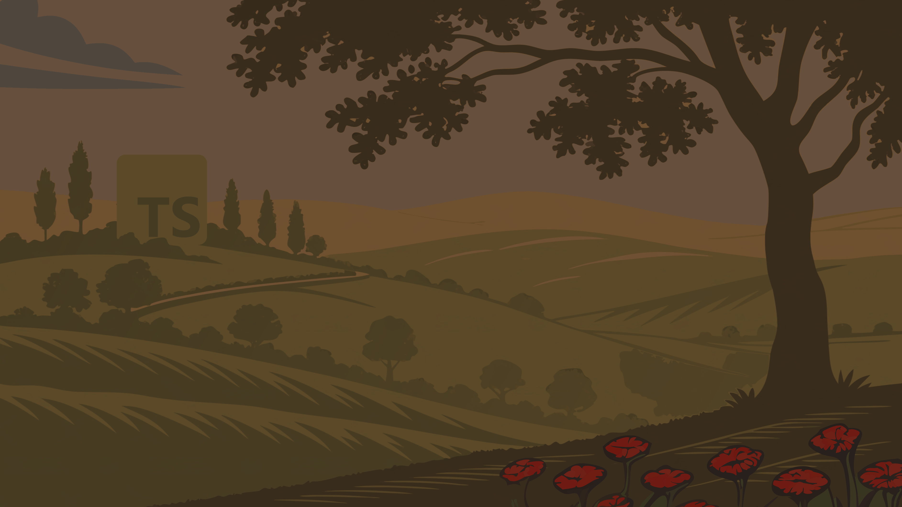

  
  
  <v-switch>
    <template #1>
      

        Vous a-t-on déjà parlé du merveilleux royaume de <strong>TypeScript</strong> ?
      

    </template>
    <template #2>
      

        Un monde enchanté où les types règnent en maîtres...
      

    </template>
    <template #3>
      

        Mais cette magie a une limite fatale…
      

    </template>
    <template #4>
      

        À la frontière du <strong>build</strong>, elle disparaît.
      

    </template>
    <template #5>
      

        <strong>C'est là que commence notre histoire.</strong>
      

    </template>
  </v-switch>

