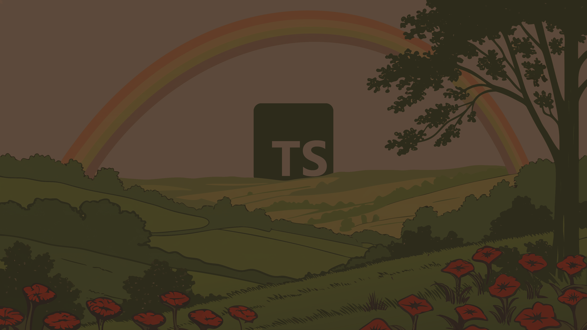

  
  
  <v-switch>
    <template #1>
      

        Un royaume où régnait l'ordre et la sérénité.
      

    </template>
    <template #2>
      

        Les développeurs y vivaient heureux, protégés par une <strong>magie ancienne</strong>.
      

    </template>
    <template #3>
      

        Cette magie s'appelait <strong>TypeScript</strong>.
      

    </template>
    <template #4>
      

        Elle veillait sur eux, les avertissant du danger avant même qu'il n'arrive.
      

    </template>
    <template #5>
      

        <strong>Tout semblait parfait...</strong>
      

    </template>
  </v-switch>

