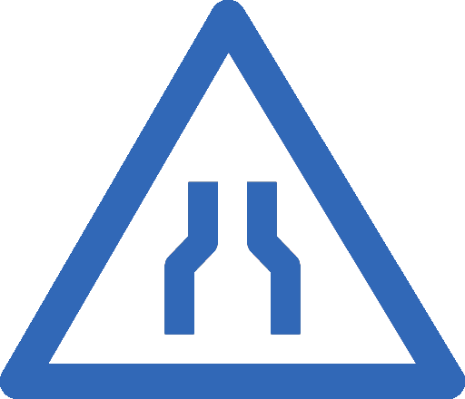

--- 

# Fonctionnalités avancées

<div class="flex gap-8 h-full items-start">

<div
  v-click
  v-motion
  :initial="{ opacity: 0, x: -20 }"
  :enter="{ opacity: 1, x: 0, transition: { type: 'spring', stiffness: 200, damping: 20 } }"
  class="w-[60%] pt-15"
>

<MacWindow title="advanced.ts" height="240px">

```ts {*|1|3|5|7-12}{lines:true,at:2}
const user = { name: "Dorothy", age: 16 }  // type inféré !

type UserDTO = Partial<Pick<typeof user, "name">>

type Status = "pending" | "success" | "error"

function handle(value: string | number) {
  if (typeof value === "string") {
    return value.toUpperCase()  // TS sait que c'est un string
  }
  return value * 2  // TS sait que c'est un number
}
```

</MacWindow>

</div>

<div class="flex-1 grid grid-cols-2 gap-6 text-center content-center">
  <div
    v-click="3"
    v-motion
    :initial="{ opacity: 0, scale: 0.5 }"
    :enter="{ opacity: 1, scale: 1, transition: { type: 'spring', stiffness: 300, damping: 15 } }"
    class="flex flex-col items-center gap-3 p-4"
  >
    
    <span class="text-base font-semibold text-black">Inférence<br/>intelligente</span>
  </div>
  <div
    v-click="4"
    v-motion
    :initial="{ opacity: 0, scale: 0.5 }"
    :enter="{ opacity: 1, scale: 1, transition: { type: 'spring', stiffness: 300, damping: 15 } }"
    class="flex flex-col items-center gap-3 p-4"
  >
    
    <span class="text-base font-semibold text-black">Génériques<br/>& utilitaires</span>
  </div>
  <div
    v-click="5"
    v-motion
    :initial="{ opacity: 0, scale: 0.5 }"
    :enter="{ opacity: 1, scale: 1, transition: { type: 'spring', stiffness: 300, damping: 15 } }"
    class="flex flex-col items-center gap-3 p-4"
  >
    
    <span class="text-base font-semibold text-black">Union &<br/>intersection</span>
  </div>
  <div
    v-click="6"
    v-motion
    :initial="{ opacity: 0, scale: 0.5 }"
    :enter="{ opacity: 1, scale: 1, transition: { type: 'spring', stiffness: 300, damping: 15 } }"
    class="flex flex-col items-center gap-3 p-4"
  >
    
    <span class="text-base font-semibold text-black">Type<br/>narrowing</span>
  </div>
</div>

</div>

<!--
Recaler les apparitions le logo
-->
