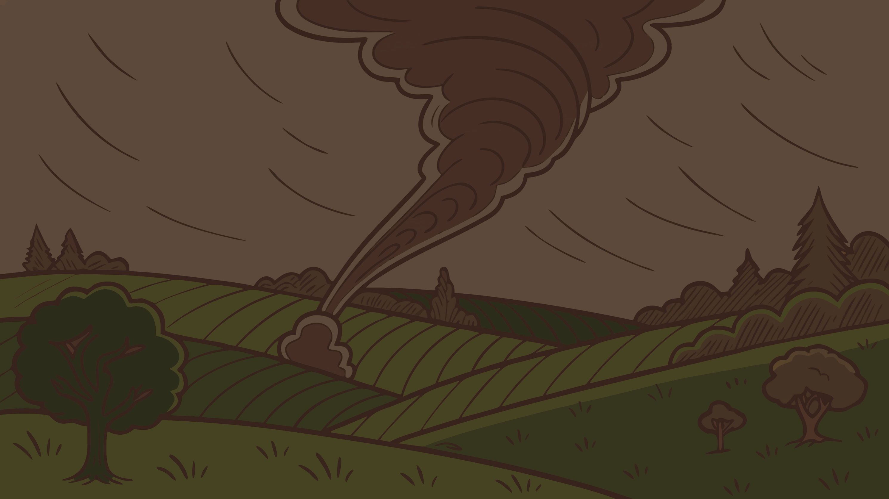

La frontière du build

---
layout: center
class: relative overflow-hidden
transition: fade-out
---

<style>
.slide-acte2 {
  position: absolute;
  inset: 0;
  display: flex;
  align-items: center;
  justify-content: center;
  overflow: hidden;
  background: #1a1a2e;
}

.img-acte2 {
  height: vh;
  width: auto;
  object-fit: contain;
  animation: tornadoVibrate 0.15s ease-in-out infinite;
}

@keyframes tornadoVibrate {
  0%, 100% {
    transform: translateX(0);
  }
  50% {
    transform: translateX(3px);
  }
}

.sub-acte2 {
  position: absolute;
  bottom: 3rem;
  left: 50%;
  transform: translateX(-50%);
  color: #F6E3D3;
  font-family: 'Noticia Text', serif;
  font-size: 1.5rem;
  text-align: center;
  max-width: 85%;
  text-shadow: 2px 2px 4px rgba(0,0,0,0.9), 0 0 10px rgba(0,0,0,0.7);
  z-index: 20;
  text-wrap: balance;
}

.sub-acte2 strong {
  color: var(--oz-gold);
}
</style>

<div class="slide-acte2">
  
  
  <v-switch>
    <template #1>
      <div class="sub-acte2">
        Un jour, une terrible <strong>tornade</strong> s'abattit sur le royaume.
      </div>
    </template>
    <template #2>
      <div class="sub-acte2">
        <strong>La tornade du build...</strong>
      </div>
    </template>
    <template #3>
      <div class="sub-acte2">
        Elle emporta nos héros au-delà des frontières connues...
      </div>
    </template>
    <template #4>
      <div class="sub-acte2">
        Dans un monde où les types n'existaient plus.
      </div>
    </template>
    <template #5>
      <div class="sub-acte2">
        <strong>Le runtime.</strong>
      </div>
    </template>
  </v-switch>
</div>

---
clicks: 2
---

# Tout a changé...

<MacWindow title="project/" height="380px">
  <div class="flex overflow-hidden" style="margin-left: 0px;">
    <SwapFiles src="assets/images/swap.svg" :clicks="$clicks" class="flex-shrink-0" />
    <SwapFiles src="assets/images/swap.svg" :clicks="$clicks" class="flex-shrink-0" />
  </div>
</MacWindow>

<div v-click="1" class="hidden"></div>
<div v-click="2" class="hidden"></div>

---

# Le code a changé aussi

<div class="flex items-center justify-center gap-6 h-[70%]">

<div class="flex-1">
<MacWindow title="api.ts" height="190px">

```ts {*}{lines:true} twoslash
interface User {
  name: string
  email: string
}

async function getUser(): Promise<User> {
  const res = await fetch("/api/user")
  return res.json()
}
```

</MacWindow>
</div>

<div class="text-5xl text-gray-400 flex-shrink-0">→</div>

<div class="flex-1 relative">
<MacWindow title="api.js" height="190px">

```js {*}{lines:true}
async function getUser() {
  const res = await fetch("/api/user")
  return res.json()
}

// interface User ? Disparu.
```

</MacWindow>

</div>

</div>

<!-- 
Pour le moment tout marche ! 
👉 Pas encore de bugs.
Juste un changement de monde.

Ce n’est pas un bug.
Ce n’est pas un défaut.
C’est le fonctionnement normal de TypeScript.

Et tant qu’on reste dans ce monde-là…
tout va bien.

Le problème commence
quand des données arrivent de l’extérieur.
-->

---

# Le navigateur ne comprend que...

<div class="flex flex-col items-center gap-8 pt-8">

<MacWindow title="Browser" height="auto">
  <div
    v-click
    v-motion
    :initial="{ opacity: 0, scale: 0.8 }"
    :enter="{ opacity: 1, scale: 1, transition: { type: 'spring', stiffness: 300, damping: 15 } }"
    class="flex items-center justify-center gap-6 py-6 px-8"
  >
    
    <span class="text-4xl font-bold text-blue-500">+</span>
    
    <span class="text-4xl font-bold text-blue-500">+</span>
    
  </div>
</MacWindow>

<div class="flex items-center gap-8 pt-8">
  
  
  <div
    v-click="3"
    v-motion
    :initial="{ opacity: 0, x: -20 }"
    :enter="{ opacity: 1, x: 0, transition: { type: 'spring', stiffness: 300, damping: 15 } }"
    class="flex items-center gap-8"
  > 
    <span class="text-6xl font-bold text-blue-500">→</span>
    <div class="relative h-28 w-40 flex items-center justify-center">
      
      <div
        v-if="$clicks >= 4"
        v-motion
        :initial="{ opacity: 0, scale: 0.5, rotate: -180 }"
        :enter="{ opacity: 1, scale: 1, rotate: 0, transition: { type: 'spring', stiffness: 300, damping: 15 } }"
        class="flex flex-col items-center gap-2 absolute"
      >
        
        <div class="flex gap-3 justify-center">
          
          
        </div>
      </div>
    </div>
    <span class="text-6xl font-bold text-blue-500">→</span>
    
  </div>
</div>

<div v-click="4" class="hidden"></div>

</div>

---

# La tornade du runtime

Au runtime, on rencontre :

<v-clicks>

- des réponses d'API
- des formulaires utilisateurs
- des variables d'environnement
- des JSON externes

</v-clicks>

<v-click>

Toutes ces données échappent à TypeScript.

</v-click>

---

# La frontière invisible

```ts
async function getUser() {
  const user: User = await fetch("/api/user")
    .then(r => r.json())
  return user
}
```

<v-clicks>

Ici :

- TypeScript est satisfait
- aucune validation n'a lieu
- le type est une promesse non vérifiée

</v-clicks>

---

# Les bugs du monde réel

```ts
user.email.toLowerCase()
```

<v-click>

Erreur en production :

```
Cannot read properties of undefined
```

</v-click>

<v-click>

Le bug n'est pas une surprise, il est **inévitable** sans validation runtime.

</v-click>

---

# Le vent se lève...

Les données du runtime sont **imprévisibles**.

<v-click>

Nos héros réalisent qu'ils ont besoin d'aide.

</v-click>

<v-click>

On leur parle d'un **magicien**...

</v-click>

<v-click>

Un magicien capable de protéger le runtime.

</v-click>
