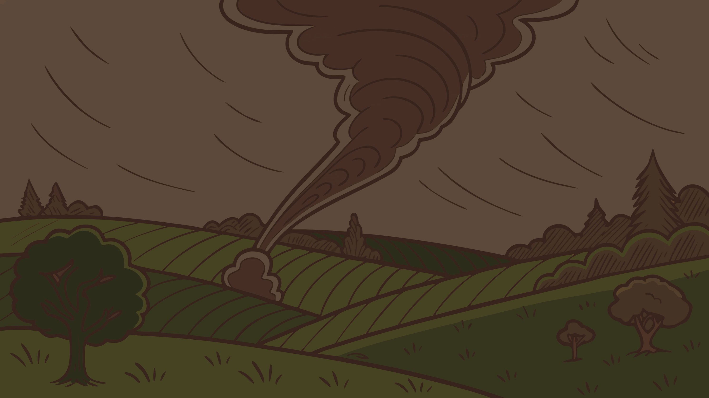

  
  
  <v-switch>
    <template #1>
      

        Un jour, une terrible <strong>tornade</strong> s'abattit sur le royaume.
      

    </template>
    <template #2>
      

        <strong>La tornade du build...</strong>
      

    </template>
    <template #3>
      

        Elle nous emporta au-delà des frontières connues...
      

    </template>
    <template #4>
      

        Dans un monde où les types n'existaient plus.
      

    </template>
    <template #5>
      

        <strong>Le runtime.</strong>
      

    </template>
  </v-switch>

