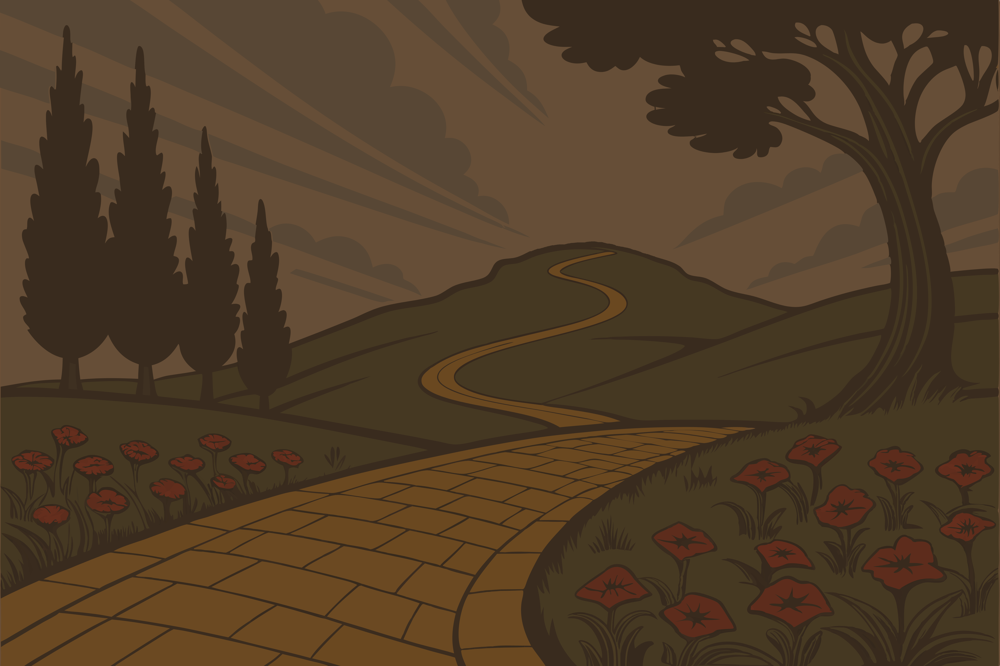

La quête

---
layout: center
class: relative overflow-hidden
transition: none
---

  

    
  

  
  <v-switch>
    <template #1>
      

        Perdus dans ce nouveau monde, nos héros cherchent une solution.
      

    </template>
    <template #2>
      

        On leur parle d'une <strong>route de briques jaunes</strong>...
      

    </template>
    <template #3>
      

        Elle mène vers un magicien capable de résoudre tous leurs problèmes.
      

    </template>
    <template #4>
      

        Mais avant, ils croiseront des <strong>imposteurs</strong>.
      

    </template>
    <template #5>
      

        <strong>La quête commence.</strong>
      

    </template>
  </v-switch>

---

# La route de briques jaunes

Objectifs :

<v-clicks>

- valider les données au runtime
- éviter la duplication types / validation
- conserver une seule source de vérité

</v-clicks>

---

# Les faux magiciens

Solutions courantes :

<v-clicks>

- des `if` partout
- des validateurs manuels
- des schémas séparés des types

</v-clicks>

<v-click>

Conséquences :

</v-click>

<v-clicks>

- incohérences
- dette technique
- bugs silencieux

</v-clicks>

<v-click>

**Il faut une autre approche.**

</v-click>
