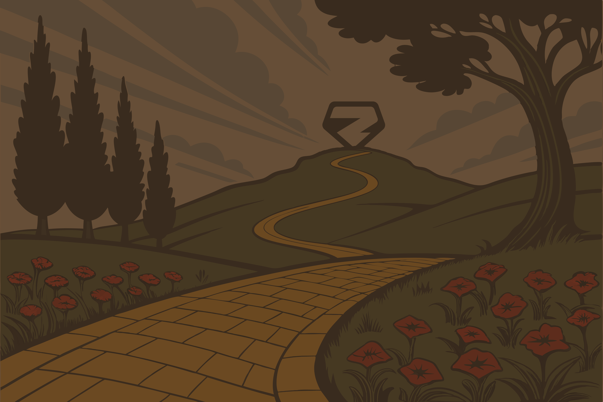

Le Magicien Zod

---
layout: center
class: relative overflow-hidden
transition: fade-out
---

<style>
.path-slide-4 {
  position: absolute;
  inset: 0;
  display: flex;
  align-items: center;
  justify-content: center;
  top: -1Opx;
}

.path-wrapper-4 {
  animation: walkBob4 1.2s ease-in-out infinite;
}

.path-img-4 {
  animation: pathMove4 30s linear forwards;
}

@keyframes pathMove4 {
  0% {
    transform: scale(1.0) translate(-30px, 50px);
  }
  100% {
    transform: scale(2.2) translate(-50px, 100px);
  }
}

@keyframes walkBob4 {
  0%, 100% {
    transform: translateY(0);
  }
  50% {
    transform: translateY(6px);
  }
}

.subtitle-box {
  position: absolute;
  bottom: 3rem;
  left: 50%;
  transform: translateX(-50%);
  color: #F6E3D3;
  font-family: 'Noticia Text', serif;
  font-size: 1.5rem;
  text-align: center;
  max-width: 85%;
  text-shadow: 2px 2px 4px rgba(0,0,0,0.9), 0 0 10px rgba(0,0,0,0.7);
  z-index: 20;
}

.subtitle-box strong {
  color: var(--oz-gold);
}
</style>

<div class="path-slide-4">
  <div class="path-wrapper-4">
    
  </div>
  
  <v-switch>
    <template #1>
      <div class="subtitle-box">
        Après un long voyage sur la route de briques jaunes...
      </div>
    </template>
    <template #2>
      <div class="subtitle-box">
        Nos héros arrivent devant les portes de la <strong>Cité d'Émeraude</strong>.
      </div>
    </template>
    <template #3>
      <div class="subtitle-box">
        Derrière ces portes, un magicien les attend.
      </div>
    </template>
    <template #4>
      <div class="subtitle-box">
        On dit qu'il peut <strong>unifier deux mondes</strong> : celui du build et celui du runtime.
      </div>
    </template>
    <template #5>
      <div class="subtitle-box">
        Son nom ? <strong>Zod</strong>.
      </div>
    </template>
  </v-switch>
</div>

---

# L'apparition de Zod

Zod est :

<v-clicks>

- un système de schémas exécutables
- un validateur runtime
- un générateur de types TypeScript

</v-clicks>

<v-click>

**Un seul artefact pour deux mondes.**

</v-click>

---

# Le sort de protection
La définition d'un schéma

````md magic-move
```ts
type User = {
  id: string;
  email: string;
  permissions: string[]
}
```
```ts
type User = {
  id: string;
  email: string;
  permissions: string[]
}

// Devient
```
```ts
type User = {
  id: string;
  email: string;
  permissions: string[]
}

// Devient

const UserSchema = z.object()
```
```ts
type User = {
  id: string;
  email: string;
  permissions: string[]
}

// Devient

const UserSchema = z.object({
  id: z.string(),
  email: z.string().email(),
  permissions: z.array(z.string())
})
```
````

<br />

<v-click>

<h2>

**Tout en existant au Runtime ! 🚀**

</h2>

</v-click> 

---

# Validation
Les pouvoirs en action !

<v-clicks>

Il nous suffit d'utiliser `.parse` ou `.safeParse` ! 🪄

```ts {monaco} {height:'auto'}
import z from 'zod'

const UserSchema = z.object({
  name: z.string(),
})

export const getUser = async () =>  {
  const data = await fetch('/api/user').then(res => res.json());
  
  return data;
}
```

<div>

Et en cas d'erreur :
  - `parse()` throw une erreur
  - `safeParse()` renvoie un objet contenant les informations de l'erreur

</div>

</v-clicks>

---
punctuation: "..."
---

# Tellement de possibilitées 
La boite à outils de Zod est bien rempli

Zod nous met à disposition **bon nombres d'outils** pour aider à la validation

<div class="flex gap-2">
<div class="flex-1" v-click>
<h3>

Des primitives ...

</h3>

- `z.string()`
- `z.number()`
- `z.boolean()`
- `z.undefined()`
- `z.null()`
- `z.bigint()`
- `z.date()`
- `z.enum()`
- *Et bien plus encore*


</div>
<div class="flex-1" v-click>
<h3>

Et des utilitaires 🛠️

</h3>

- `.min()` & `.max()`
- `.length()`
- `.gt()` & `.lt()`
- `.positive()` & `.negative()`
- `optional()`
- `nullable()`
- `nullish()`
- *Et bien plus encore*

</div>
</div>


---
layout: iframe
url: https://zod-playground.vercel.app/
---

---

# La route devient sûre

Zod peut sécuriser :

<v-clicks>

- les APIs
- les formulaires
- les variables d'environnement
- les fichiers de configuration

</v-clicks>

<v-click>

<p class="font-size-4xl text-center pt-10 font-bold" style="color: var(--oz-zod-blue)">

Le runtime redevient prévisible.

</p>

</v-click>
