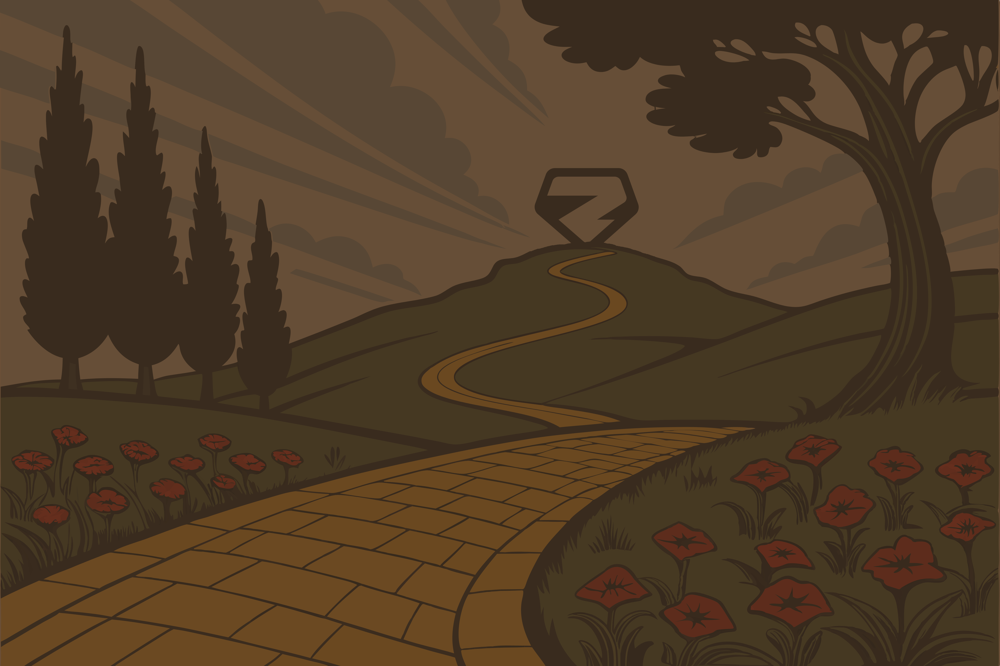

  

    
  

  
  <v-switch>
    <template #1>
      

        Après un long voyage sur la route de briques jaunes...
      

    </template>
    <template #2>
      

        Nous arrivons devant les portes de la <strong>Cité d'Émeraude</strong>.
      

    </template>
    <template #3>
      

        Derrière ces portes, un magicien les attend.
      

    </template>
    <template #4>
      

        On dit qu'il peut <strong>unifier deux mondes</strong> : celui du build et celui du runtime.
      

    </template>
    <template #5>
      

        Son nom ? <strong>Zod</strong>.
      

    </template>
  </v-switch>

