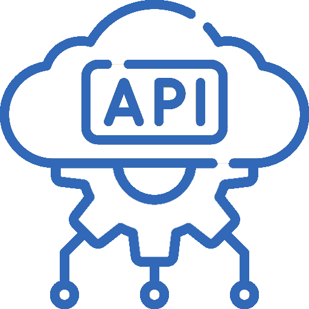

# En quoi ça résout le problème

  <!-- Colonne gauche : sources externes autour de Mon app -->
  

    <!-- API en haut à droite -->
    

      

        
      

      

        <!-- Boule de données qui transite API → App (click 7) -->
        
= 7" class="absolute -left-1.5 top-0">
          

        

      

    

    <!-- Formulaires à gauche + Mon app -->
    

      

        
      

      

        <!-- Boule de données qui transite Form → App -->
        
= 6" class="absolute -top-1.5 left-0">
          

        

      

      

        
      

    

    <!-- Fichiers en bas à droite -->
    

      

      

        
      

    

  

  

    <!-- Boule de données qui continue App → Code (click 6) -->
    
= 6 && $clicks < 7" class="absolute -top-1.5 left-0 w-3 h-3 bg-[#3168B7] rounded-full opacity-0 animate-ball-app-code">

    <!-- Boule de données qui continue App → Code (click 7) -->
    
= 7" class="absolute -top-1.5 left-0 w-3 h-3 bg-[#3168B7] rounded-full opacity-0 animate-ball-app-code-2">

  

  <!-- Mon code avec Types et Schéma -->
  

    <!-- Types au dessus avec ❌ -->
    

      
Types ❌

      

    

    <!-- Code icon -->
    

      
      
= 4" v-motion :initial="{ opacity: 0, scale: 0 }" :enter="{ opacity: 1, scale: 1, transition: { type: 'spring', stiffness: 300, damping: 15 } }" class="absolute -right-20 flex items-center gap-2">
        +
        
      

      <!-- Click 6: Loader puis Cross (positionné en absolu) -->
      
= 6 && $clicks < 7" class="absolute -right-32 flex items-center justify-center">
        

          

          
        

      

      <!-- Click 7: Loader puis Check (positionné en absolu) -->
      
= 7" class="absolute -right-32 flex items-center justify-center">
        

          

          
        

      

    

    <!-- Schéma en dessous avec ✅ -->
    

      

      
Schéma ✅

    

  

<!-- Éléments invisibles pour enregistrer les clics 6 et 7 -->

<!--
OK, au runtime on n'a plus de types...

Mais on peut vérifier le format avec un schéma !
-->
