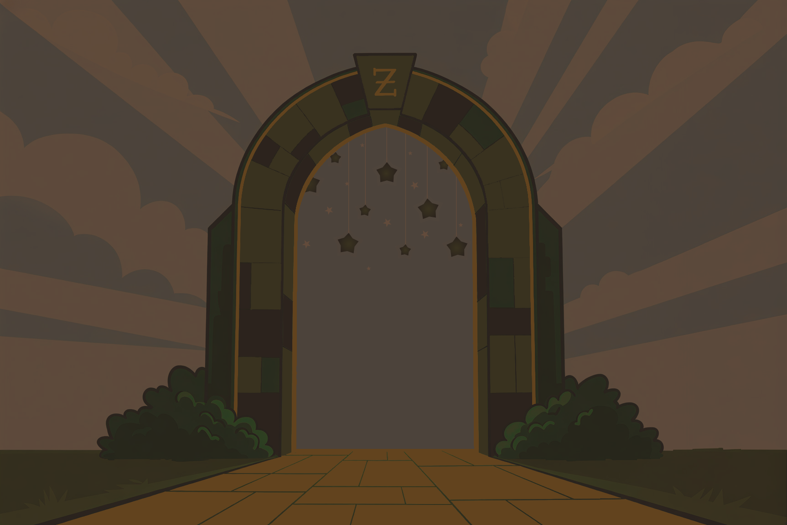

La Magie en Action

---
layout: center
class: relative overflow-hidden
transition: fade-out
---

<style>
.path-slide-5 {
  position: absolute;
  inset: 0;
  display: flex;
  align-items: center;
  justify-content: center;
  overflow: hidden;
  background: #1a1a2e;
}

.path-img-5 {
  height: 60vh;
  width: 100%;
  object-fit: contain;
  animation: pathMove5 15s linear forwards;
}

@keyframes pathMove5 {
  0% {
    transform: scale(1.1) translateY(-10px);
  }
  100% {
    transform: scale(1.2) translateY(100px);
  }
}

.subtitle-box {
  position: absolute;
  bottom: 3rem;
  left: 50%;
  transform: translateX(-50%);
  color: #F6E3D3;
  font-family: 'Noticia Text', serif;
  font-size: 1.5rem;
  text-align: center;
  max-width: 85%;
  text-shadow: 2px 2px 4px rgba(0,0,0,0.9), 0 0 10px rgba(0,0,0,0.7);
  z-index: 20;
}

.subtitle-box strong {
  color: var(--oz-gold);
}
</style>

<div class="path-slide-5">
  
  
  <v-switch>
    <template #1>
      <div class="subtitle-box">
        Le magicien a révélé ses secrets.
      </div>
    </template>
    <template #2>
      <div class="subtitle-box">
        Mais connaître un sort ne suffit pas...
      </div>
    </template>
    <template #3>
      <div class="subtitle-box">
        Il faut <strong>l'appliquer</strong> dans le monde réel.
      </div>
    </template>
    <template #4>
      <div class="subtitle-box">
        Nos héros vont affronter les <strong>épreuves du quotidien</strong>.
      </div>
    </template>
    <template #5>
      <div class="subtitle-box">
        <strong>Que la magie opère !</strong>
      </div>
    </template>
  </v-switch>
</div>

---

# Des héros transformés

Grâce à Zod :

<v-clicks>

- fini le `any`
- confiance réelle dans les données
- refactoring sans peur

</v-clicks>

<v-click>

**Zod renforce TypeScript, il ne le remplace pas.**

</v-click>

---

# Inférence automatique
Une source de vérité unique !


````md magic-move
```ts
const UserSchema = z.object({
    id: z.number(),
    name: z.string(),
    permission: z.array(z.string()),
})
```
```ts
const UserSchema = z.object({
    id: z.number(),
    name: z.string(),
    permission: z.array(z.string()),
})

const user: [???] = {...}
```
```ts
const UserSchema = z.object({
    id: z.number(),
    name: z.string(),
    permission: z.array(z.string()),
})

type User = z.infer<typeof UserSchema>;

const user: User = {...}
```
````

<v-click>
<h2 class="pt-10">

Le schéma deviens la source de vérité ! 🗺️

</h2>
</v-click>

<v-click>

<br />

Zod nous protège au **Runtime** ET au **BuildTime**

</v-click>

---

# Input vs Output

Quand un schéma **transforme** les données :

```ts
const Schema = z.string().transform(v => v.length)
```

<v-click>

```ts
type Input = z.input<typeof Schema>   // string
type Output = z.output<typeof Schema> // number
```

</v-click>

<v-click>

*Peut s'avérer très utile dans le cas d'un formulaire !*

</v-click>