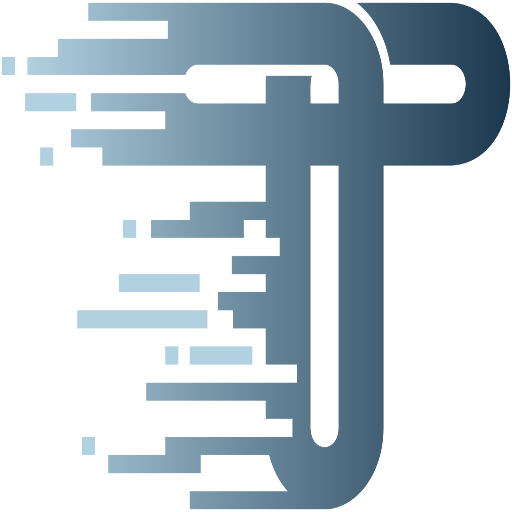

La Sorcière de l'Ouest

---
layout: story
---

Mais toute magie a un prix...

<v-click>

La **Sorcière de l'Ouest** rode.

</v-click>

<v-click>

Elle murmure des vérités dérangeantes :

</v-click>

<v-click>

*"Ce magicien n'est pas parfait..."*

</v-click>

<v-click>

*"Il a des faiblesses..."*

</v-click>

<v-click>

**Et elle n'a pas tort.**

</v-click>

---

# Ce n'est pas de la magie

  

    
    

      
Performance

      Le parsing n'est pas gratuit
    

  

  

    
    

      
Bundle Size

      ~50kb minifié
    

  

  

    
    

      
Complexité DX

      Un outil de plus à maîtriser
    

  

---

# Zod ne remplace pas TypeScript

  

    
  

  

    <ul class="space-y-3 text-[#2D3748]">
      <li class="flex items-start gap-2">
        →
        Validation <strong>statique</strong> (compile-time)
      </li>
      <li class="flex items-start gap-2">
        →
        S'efface à la compilation
      </li>
      <li class="flex items-start gap-2">
        →
        Protège le <strong>code interne</strong>
      </li>
    </ul>
  

  

    
  

  

    <ul class="space-y-3 text-[#2D3748]">
      <li class="flex items-start gap-2">
        →
        Validation <strong>dynamique</strong> (runtime)
      </li>
      <li class="flex items-start gap-2">
        →
        S'exécute dans le bundle
      </li>
      <li class="flex items-start gap-2">
        →
        Protège les <strong>frontières</strong>
      </li>
    </ul>
  

<v-click>

  Ils sont <strong class="text-[#3168B7]">complémentaires</strong>, pas concurrents.

</v-click>

---

# Les alternatives

  

    
    Zod Mini
  

  

    
    Valibot
  

  

    
    TypeBox
  

  

    
    ArkType
  

  

    
    Typia
  

 

<v-click>

  
→ Performances au Runtime

  
→ Taille du bundle

  
→ Facilité d'écriture

  
→ Intégration IDE

  
→ Écosystème TypeScript

  
→ Features additionnelles

</v-click>

<v-click>

  Des philosophies et des fonctionnements très différents.

</v-click> 
<v-click>

  Mais un <strong class="text-[#3168B7]">objectif commun</strong> : valider les données au runtime !

</v-click>

---

# La naissance d'un standard

  

    
    
    
    
  

  →
  

<v-click>

  Un standard pour permettre à tous les outils d'interagir avec toutes les bibliothèques de validation.

</v-click>

  <a href="https://standardschema.dev/" target="_blank">standardschema.dev</a>

---

# Quand (ne pas) utiliser Zod ?

  
  
Des inputs que vous ne contrôlez pas

  
→ <strong class="text-[#3168B7]">Utilisez</strong> 

  
  
Des inputs de confiance mais externes

  
→ <strong class="text-[#3168B7]">Validez avec</strong> 

  
  
Des inputs internes et contrôlés

  
→ <strong>Pas besoin de</strong> 

  
  
Des données passées entre vos fonctions

  
→  <strong>suffit</strong>

  
  
Des boucles critiques en performance

  
→ <strong>Pas besoin de</strong> 

