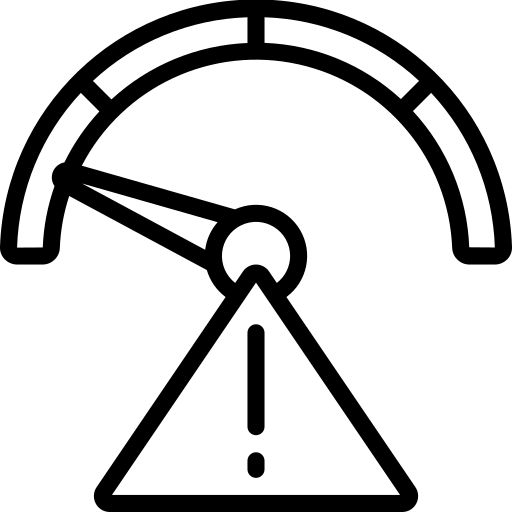
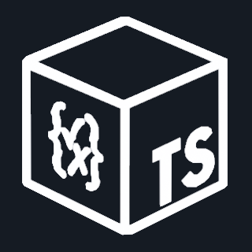

La Sorcière de l'Ouest

---
layout: story
---

Mais toute magie a un prix...

<v-click>

La **Sorcière de l'Ouest** rode.

</v-click>

<v-click>

Elle murmure des vérités dérangeantes :

</v-click>

<v-click>

*"Ce magicien n'est pas parfait..."*

</v-click>

<v-click>

*"Il a des faiblesses..."*

</v-click>

<v-click>

**Et elle n'a pas tort.**

</v-click>

---

# Ce n'est pas de la magie

Zod a un coût :


<div class="flex-1 grid grid-cols-3 text-center items-end mt-25">
  <div
    v-click
    v-motion
    :initial="{ opacity: 0, scale: 0.5 }"
    :enter="{ opacity: 1, scale: 1, transition: { type: 'spring', stiffness: 300, damping: 15 } }"
    class="flex flex-col items-center gap-6"
  >
    
    <span class="text-base text-black text-xl"><strong>Performance :</strong><br />Les parsing n'est pas gratuit</span>
  </div>
  <div
    v-click
    v-motion
    :initial="{ opacity: 0, scale: 0.5 }"
    :enter="{ opacity: 1, scale: 1, transition: { type: 'spring', stiffness: 300, damping: 15 } }"
    class="flex flex-col items-center gap-6"
  >
    
    <span class="text-base text-black text-xl"><strong>Bundle size : </strong><br/>~50kb minifié</span>
  </div>
  <div
    v-click
    v-motion
    :initial="{ opacity: 0, scale: 0.5 }"
    :enter="{ opacity: 1, scale: 1, transition: { type: 'spring', stiffness: 300, damping: 15 } }"
    class="flex flex-col items-center gap-6"
  >
    
    <span class="text-base text-black text-xl"><strong>Complexité :</strong><br/>Nouvel outil à apprendre</span>
  </div>
</div>


---

# Le coût de la validation

```ts
// ❌ Ne pas faire dans une boucle hot path
for (const item of millionsOfItems) {
  const validated = Schema.parse(item) // Coût à chaque itération
}
```

<v-click>

```ts
// ✅ Valider une fois à l'entrée
const validatedItems = Schema.array().parse(millionsOfItems)
for (const item of validatedItems) {
  // Déjà validé, pas de coût supplémentaire
}
```

</v-click>

---

# Benchmarks

| Librairie | ops/sec | Taille |
|-----------|---------|--------|
| Zod | ~300k | ~50kb |
| Valibot | ~500k | ~5kb |
| TypeBox | ~800k | ~30kb |
| ArkType | ~1M | ~40kb |

<v-click>

**En pratique** : la différence est négligeable aux frontières (API, forms).

</v-click>

<v-click>

Optimisez là où ça compte, pas partout.

</v-click>

---

# Quand NE PAS utiliser Zod

<v-clicks>

- Données internes déjà typées
- Hot paths critiques en performance
- Projets très légers (overkill)
- Validation simple → `typeof` suffit

</v-clicks>

---

# Les alternatives

<div class="grid grid-cols-4 gap-6 mt-12">
  <div 
    class="flex flex-col items-center gap-3"
    v-motion
    v-click="1"
    :initial="{ opacity: 0, y: 20 }" 
    :enter="{ opacity: 1, y: 0 }"
    :duration="500"
  >
    <div class="w-28 h-28 flex items-center justify-center bg-white/10 rounded-2xl shadow-lg">
      
    </div>
    <div class="text-center">
      <strong class="text-xl">Valibot</strong>
      <p class="text-sm opacity-80 mt-1">Plus léger (~5kb)<br/>tree-shakable</p>
    </div>
  </div>

  <div 
    class="flex flex-col items-center gap-3"
    v-motion
    v-click="2"
    :initial="{ opacity: 0, y: 20 }" 
    :enter="{ opacity: 1, y: 0 }"
    :duration="500"
  >
    <div class="w-28 h-28 flex items-center justify-center bg-white/10 rounded-2xl shadow-lg">
      
    </div>
    <div class="text-center">
      <strong class="text-xl">TypeBox</strong>
      <p class="text-sm opacity-80 mt-1">Génère aussi des<br/>JSON Schemas</p>
    </div>
  </div>

  <div 
    class="flex flex-col items-center gap-3"
    v-motion
    v-click="3"
    :initial="{ opacity: 0, y: 20 }" 
    :enter="{ opacity: 1, y: 0 }"
    :duration="500"
  >
    <div class="w-28 h-28 flex items-center justify-center bg-white/10 rounded-2xl shadow-lg">
      
    </div>
    <div class="text-center">
      <strong class="text-xl">ArkType</strong>
      <p class="text-sm opacity-80 mt-1">Syntaxe plus proche<br/>de TypeScript</p>
    </div>
  </div>

  <div 
    class="flex flex-col items-center gap-3"
    v-motion
    v-click="4"
    :initial="{ opacity: 0, y: 20 }" 
    :enter="{ opacity: 1, y: 0 }"
    :duration="500"
  >
    <div class="w-28 h-28 flex items-center justify-center bg-white/10 rounded-2xl shadow-lg">
      
    </div>
    <div class="text-center">
      <strong class="text-xl">Zod Mini</strong>
      <p class="text-sm opacity-80 mt-1">Version allégée<br/>officielle (expérimental)</p>
    </div>
  </div>
</div>

<div class="text-2xl mt-12" v-click="5">

Choisissez l'outil adapté à votre **contexte**.

</div>

---

# La naissance d'un standard
Une interface commune

En avril 2024, plusieurs créateurs de bibliothèques se sont regroupés pour créer ...

<div 
  class="flex justify-center items-center h-[250px]" 
  v-motion
  v-click
  :initial="{ opacity: 0 }" 
  :enter="{ opacity: 1 }"
  :duration="500" 
>
  <div class="flex flex-col items-center gap-4">
    
    <strong class="text-3xl">Standard Schema</strong>
  </div>
</div>

<v-click>

Un standard pour permettre à tout les outils d'interagir avec toutes les bibliothèques de validation de schémas

</v-click>
---

# La sorcière n'a pas gagné

<v-click>

Ces limites sont **connues et acceptables** :

</v-click>

<div class="flex flex-col items-center gap-6 mt-20">
  <div 
    class="text-center"
    v-motion
    v-click
    :initial="{ opacity: 0, y: 30, scale: 0.9 }" 
    :enter="{ opacity: 1, y: 0, scale: 1 }"
    :duration="600"
  >
    <p class="text-3xl font-bold text-gray-700">
      L'utilisation de Zod a un coût ...
    </p>
  </div>

  <div 
    class="text-center"
    v-motion
    v-click
    :initial="{ opacity: 0, y: 30, scale: 0.9 }" 
    :enter="{ opacity: 1, y: 0, scale: 1 }"
    :duration="600"
  >
    <p class="text-3xl font-bold" style="color: var(--oz-emerald);">
      Mais qui assure une sécurité certaine
    </p>
  </div>

  <div 
    class="text-center"
    v-motion
    v-click
    :initial="{ opacity: 0, y: 30, scale: 0.9 }" 
    :enter="{ opacity: 1, y: 0, scale: 1 }"
    :duration="600"
  >
    <p class="text-3xl font-bold text-gray-700">
      Zod reste le choix pragmatique pour la plupart des cas.
    </p>
  </div>
</div>
