  
  
  <v-switch>
    <template #1>
      

        Mais toute magie a un prix...
      

    </template>
    <template #2>
      

        La <strong>Sorcière de l'Ouest</strong> rode.
      

    </template>
    <template #3>
      

        Elle murmure des vérités dérangeantes :
      

    </template>
    <template #4>
      

        <em>"Ce magicien n'est pas parfait..."</em>
      

    </template>
    <template #5>
      

        <em>"Il a des faiblesses..."</em>
      

    </template>
    <template #6>
      

        <strong>Et elle n'a pas tort.</strong>
      

    </template>
  </v-switch>

<!--
Reset le zoom
-->
