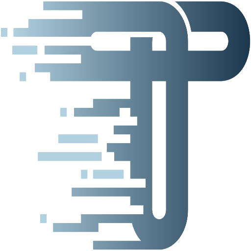

# Les alternatives

  

    
    Zod Mini
  

  

    
    Valibot
  

  

    
    TypeBox
  

  

    
    ArkType
  

  

    
    Typia
  

 

<v-click>

  
→ Performances au Runtime

  
→ Taille du bundle

  
→ Facilité d'écriture

  
→ Intégration IDE

  
→ Écosystème TypeScript

  
→ Features additionnelles

</v-click>

<v-click>

  Des philosophies et des fonctionnements très différents.

</v-click> 
<v-click>

  Mais un <strong class="text-[#3168B7]">objectif commun</strong> : valider les données au runtime !

</v-click>
