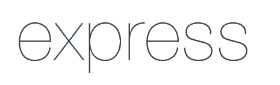
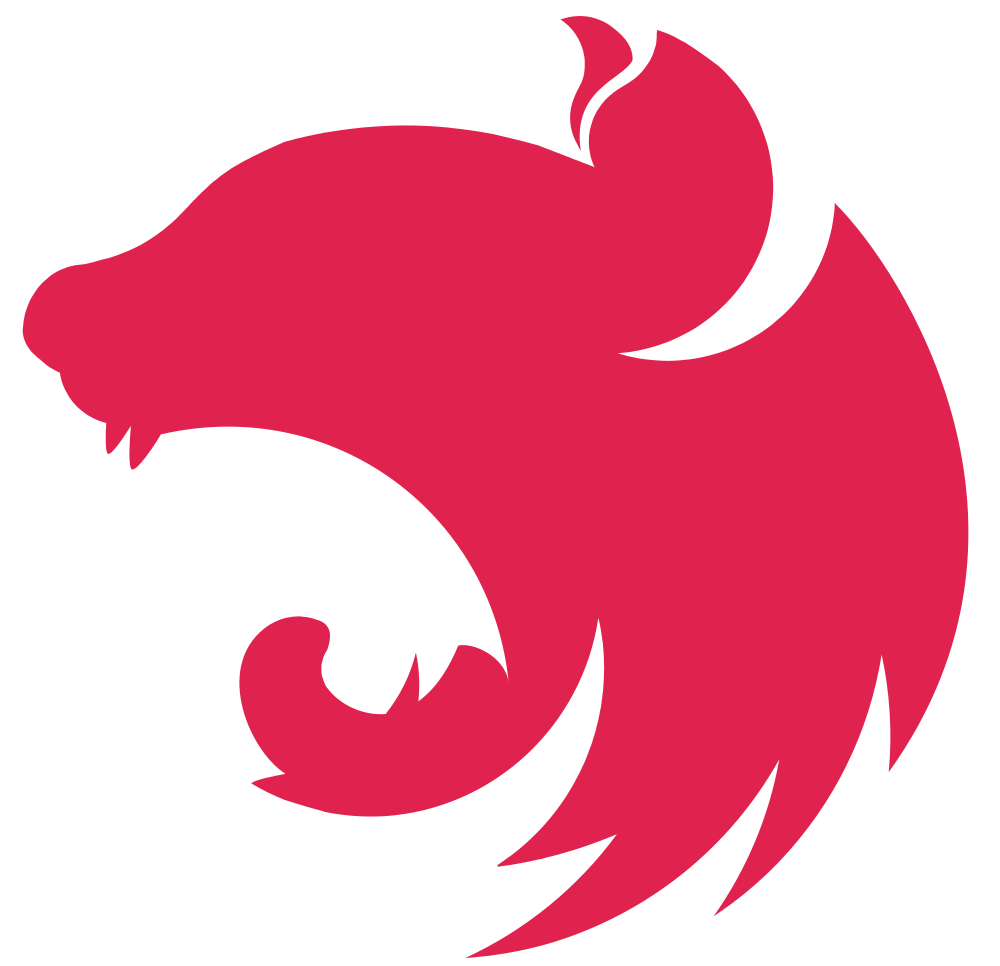
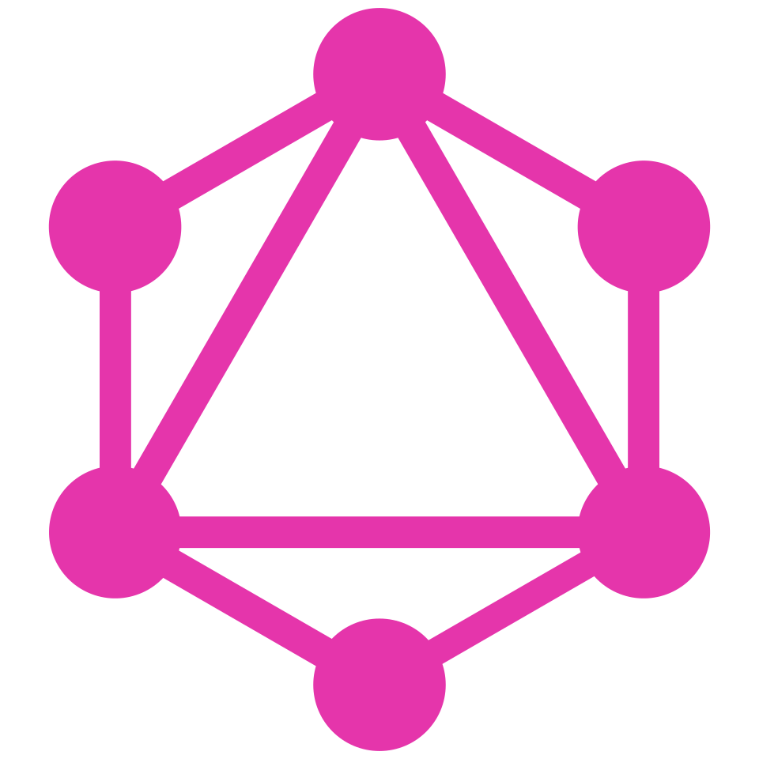
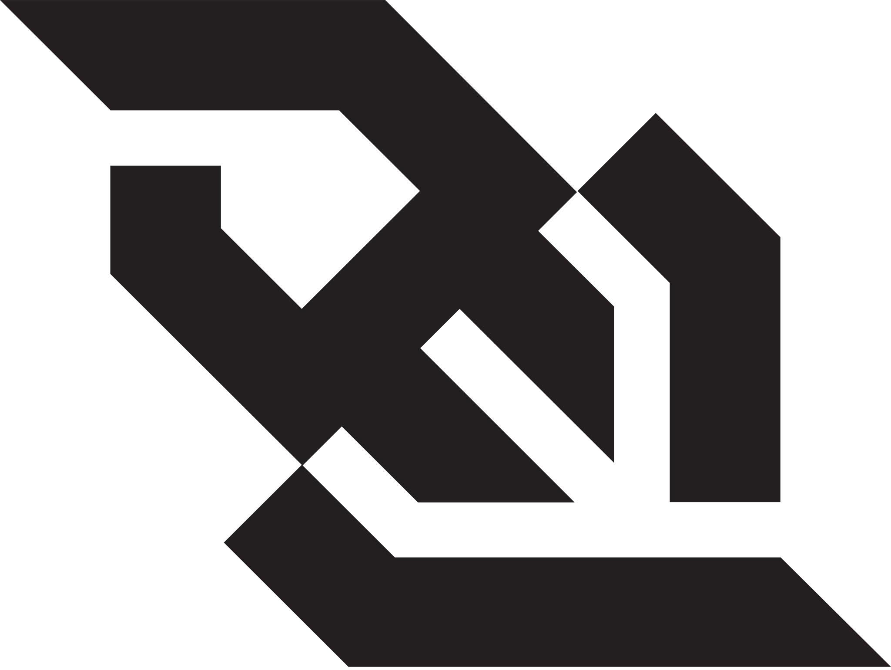

# Request

<div class="flex justify-center items-stretch gap-8">
    <div class="request-window-container overflow-hidden">
        <Request />
    </div>
</div>


<style>
.request-window-container {
  view-transition-name: animated-request;
}

::view-transition-old(animated-request),
::view-transition-new(animated-request) {
  animation: none;
}
</style>

---
transition: view-transition
---

# Request

<div class="flex justify-center items-stretch gap-8">
    <div class="request-window-container overflow-hidden">
        <Request />
    </div>
    <MacWindow title="Request schema" label="Backend" style="min-width: 400px">
<<< ./components/requests/request-schema.ts {monaco-write} {height: 'auto'}
    </MacWindow>
</div>

<style>
.request-window-container {
  view-transition-name: animated-request;
}

::view-transition-old(animated-request),
::view-transition-new(animated-request) {
  animation: none;
}
</style>

---
transition: view-transition
---

# Request

<div class="flex justify-center items-stretch gap-8">
    <div class="request-window-container overflow-hidden">
        <Request method="PATCH" />
    </div>
    <MacWindow title="Request schema" label="Backend" style="min-width: 400px">
<<< ./components/requests/request-patch-schema.ts {monaco-write} {height: 'auto'}
    </MacWindow>
</div>

<style>
.request-window-container {
  view-transition-name: animated-request;
}

::view-transition-old(animated-request),
::view-transition-new(animated-request) {
  animation: none;
}
</style>

---
transition: fade
---

# Inférence automatique


<MacWindow title="Inférence de type" height="fit-content">

```ts {1-7|11|9}{lines:true} twoslash
// @noErrors
import { z } from 'zod'
// ---cut---
export const PostRequestBodySchema = z.object({
  id: z.string().uuid(),
  title: z.string().min(4).max(100),
  pageCount: z.number().min(1),
  thumbnail: z.string().url(),
  hasBeenRead: z.boolean(),
})

type PostRequestBody = z.infer<typeof PostRequestBodySchema>

const body: PostRequestBody = {...}
```

</MacWindow>

<div v-click="3">
  <div v-if="$clicks >= 3" class="text-center text-3xl font-bold pt-10">
    <h2>Le schéma devient la <span v-mark="{ at: 3, type: 'highlight', color: '#3168B7' }" class="text-white">source de vérité</span></h2>
    <p class="text-lg">Zod nous protège au <span v-mark="{ at: 3, type: 'underline', color: '#3168B7' }" class="text-[#3168B7] font-semibold">Runtime</span> ET au <span v-mark="{ at: 3, type: 'underline', color: '#3168B7' }" class="text-[#3168B7] font-semibold">BuildTime</span></p>
  </div>
</div>

---

# L'écosystème, encore lui

<div class="flex justify-center items-center gap-15 mt-35">
  <div v-click v-motion :initial="{ opacity: 0, scale: 0 }" :enter="{ opacity: 1, scale: 1, transition: { type: 'spring', stiffness: 300, damping: 15 } }" class="flex flex-col items-center gap-3">
    
    <span class="text-sm font-bold text-[#2D3748] border border-[#2D3748] rounded px-3 py-1">express-zod-api</span>
  </div>
  <div v-click v-motion :initial="{ opacity: 0, scale: 0 }" :enter="{ opacity: 1, scale: 1, transition: { type: 'spring', stiffness: 300, damping: 15 } }" class="flex flex-col items-center gap-3">
    
    <span class="text-sm font-bold text-[#2D3748] border border-[#2D3748] rounded px-3 py-1">tRPC</span>
  </div>
  <div v-click v-motion :initial="{ opacity: 0, scale: 0 }" :enter="{ opacity: 1, scale: 1, transition: { type: 'spring', stiffness: 300, damping: 15 } }" class="flex flex-col items-center gap-3">
    
    <span class="text-sm font-bold text-[#2D3748] border border-[#2D3748] rounded px-3 py-1">zod-nestjs</span>
  </div>
  <div v-click v-motion :initial="{ opacity: 0, scale: 0 }" :enter="{ opacity: 1, scale: 1, transition: { type: 'spring', stiffness: 300, damping: 15 } }" class="flex flex-col items-center gap-3">
    
    <span class="text-sm font-bold text-[#2D3748] border border-[#2D3748] rounded px-3 py-1">GQLoom</span>
  </div>
  <div v-click v-motion :initial="{ opacity: 0, scale: 0 }" :enter="{ opacity: 1, scale: 1, transition: { type: 'spring', stiffness: 300, damping: 15 } }" class="flex flex-col items-center gap-3">
    
    <span class="text-sm h-fit font-bold text-[#2D3748] border border-[#2D3748] rounded px-3 py-1">zod-sockets</span>
  </div>
</div>
